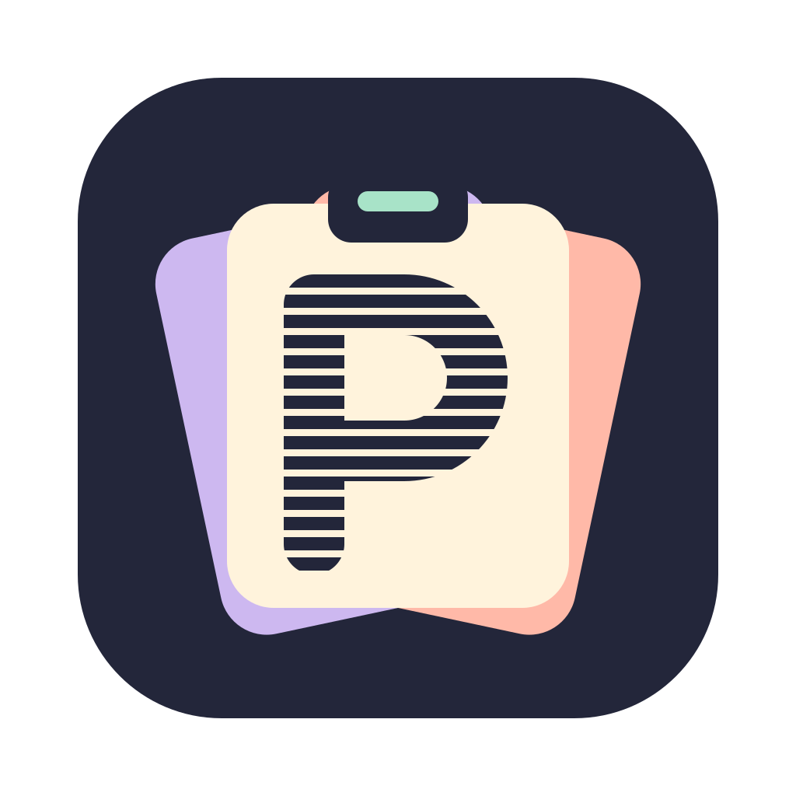
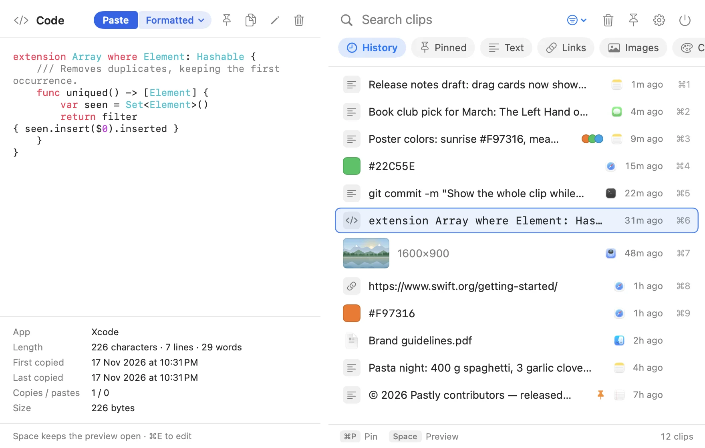
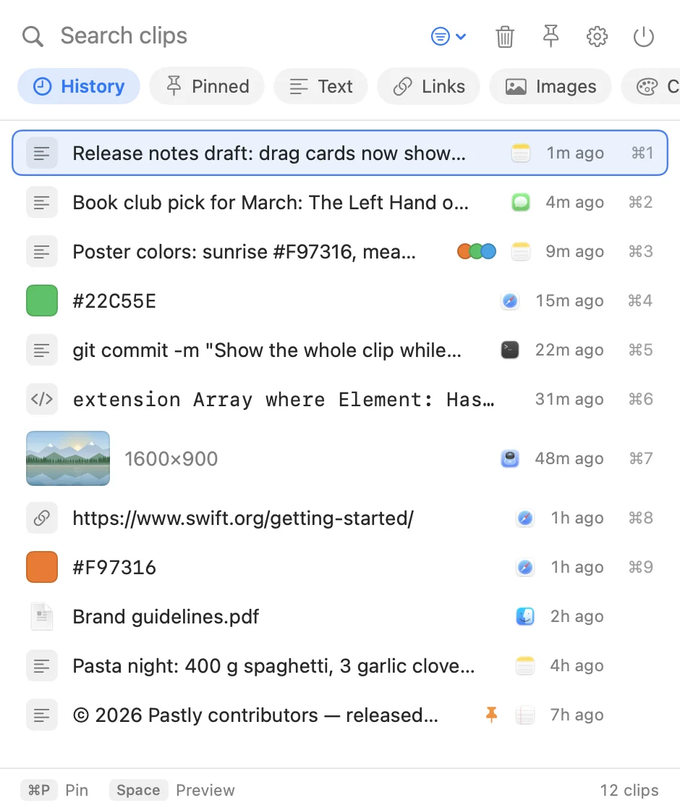
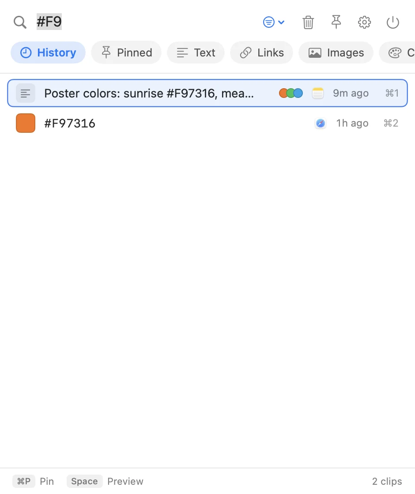
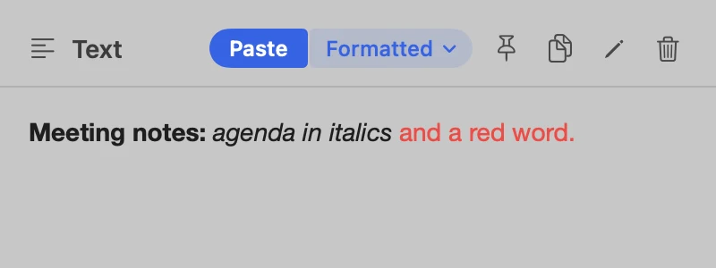
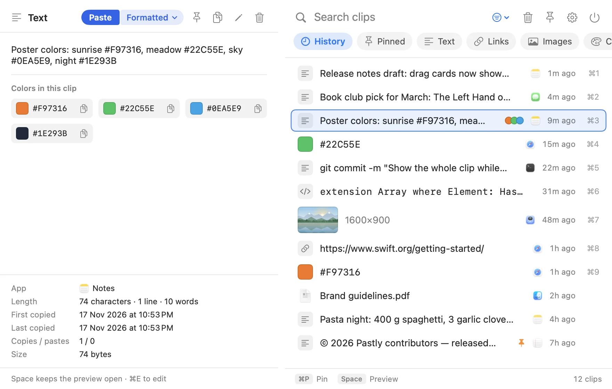
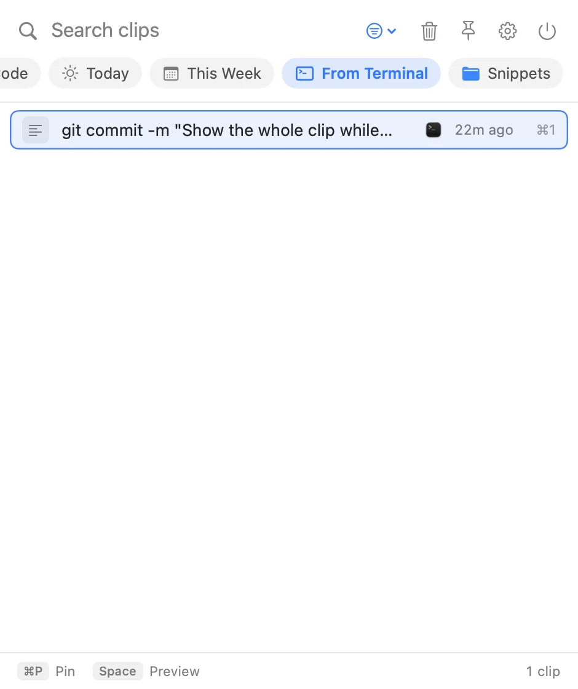
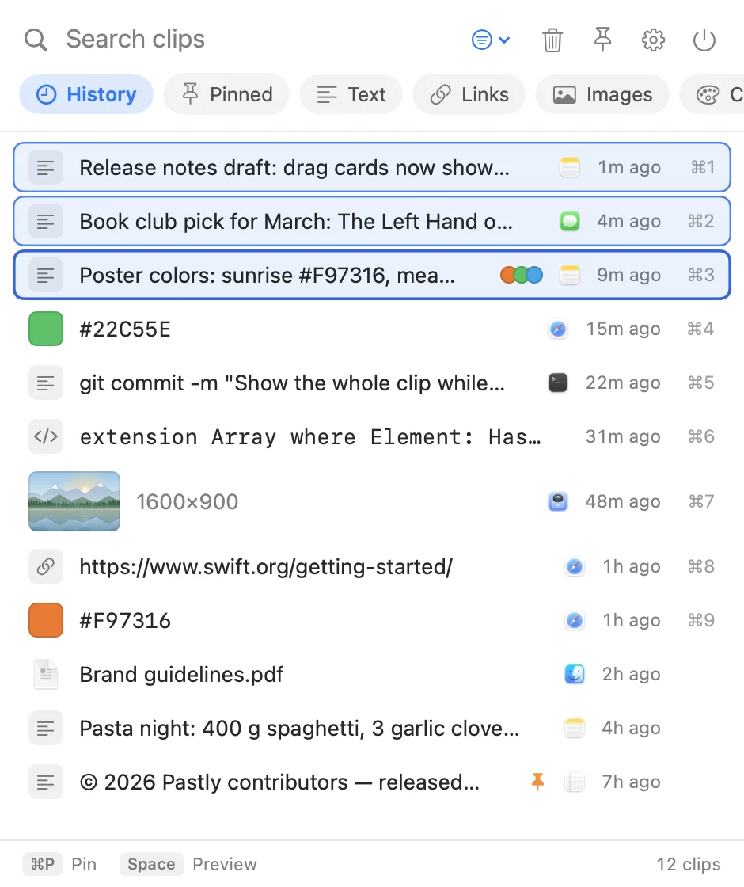
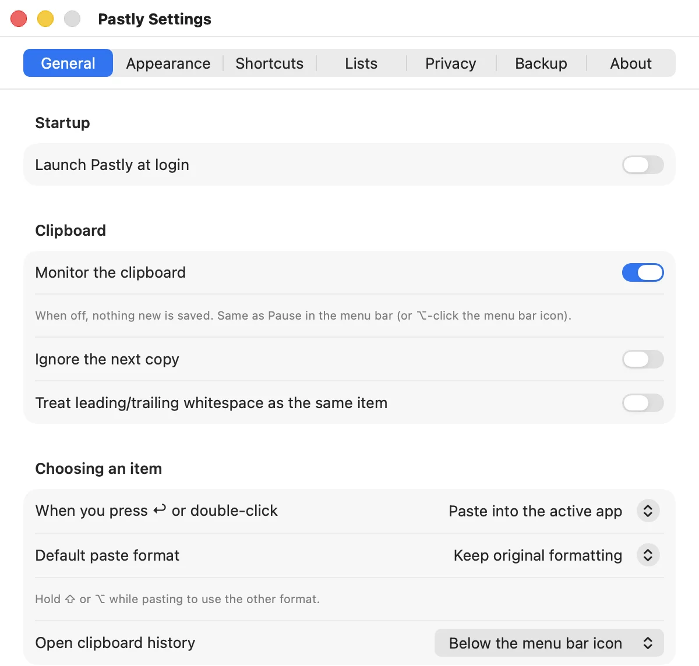
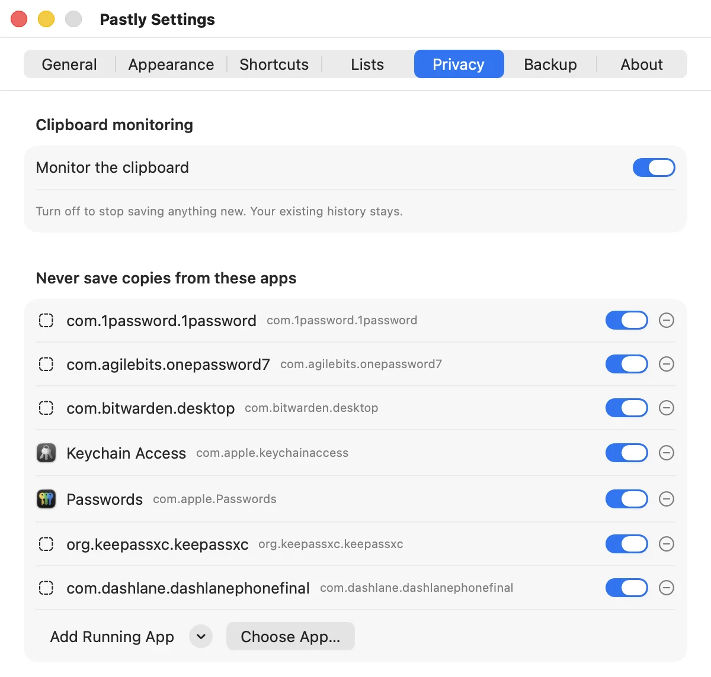

<div align="center">



# Pastly

**A beautiful, native clipboard manager for macOS.**

Everything you copy — text, links, code, colors, images, files — kept on your Mac and back in one keystroke.

[](#requirements)
[](#requirements)
[](#build-from-source)
[](LICENSE)
[](Package.swift)

[Features](#features) · [Full feature guide](FEATURES.md) · [Install](#installation) · [Usage](#usage) · [Build](#build-from-source) · [Contributing](CONTRIBUTING.md) · [Changelog](CHANGELOG.md) · Website (coming soon)

<br>

<picture>
  <source srcset="website/img/preview-code-dark.webp" media="(prefers-color-scheme: dark)">
  
</picture>

</div>

## Why Pastly

macOS remembers exactly one thing you copied. Pastly remembers all of them.

It sits in the menu bar and quietly saves every copy — with its formatting, the app it came from and when you copied it. Press **⇧⌘V** in any app, find the clip by typing a few letters, and press **↩** to paste it where your cursor was.

- **Native.** Swift, SwiftUI and AppKit, built on Apple's own frameworks. No Electron, no web views, no third-party code.
- **Private.** 100% local. No account, no cloud, no analytics. Password-manager content is never saved.
- **Free and open source.** MIT licensed. Every feature, for everyone.

## Screenshots

<table>
  <tr>
    <td width="50%" align="center">
      <picture>
        <source srcset="website/img/list-dark.webp" media="(prefers-color-scheme: dark)">
        
      </picture>
      <br><b>Clipboard history</b><br><sub>Every kind of clip, in the order you copied it.</sub>
    </td>
    <td width="50%" align="center">
      <picture>
        <source srcset="website/img/search-dark.webp" media="(prefers-color-scheme: dark)">
        
      </picture>
      <br><b>Search and filtering</b><br><sub>Just start typing. Tabs filter by kind and list.</sub>
    </td>
  </tr>
  <tr>
    <td width="50%" align="center">
      <picture>
        <source srcset="website/img/preview-formatted-dark.webp" media="(prefers-color-scheme: dark)">
        
      </picture>
      <br><b>Formatted or Plain</b><br><sub>One paste format for every paste: Paste, ↩, ⌘V, double-click, drag.</sub>
    </td>
    <td width="50%" align="center">
      <picture>
        <source srcset="website/img/preview-palette-dark.webp" media="(prefers-color-scheme: dark)">
        
      </picture>
      <br><b>Preview</b><br><sub>Full text, images, color values, source app and usage.</sub>
    </td>
  </tr>
  <tr>
    <td width="50%" align="center">
      <picture>
        <source srcset="website/img/smart-dark.webp" media="(prefers-color-scheme: dark)">
        
      </picture>
      <br><b>Smart Lists</b><br><sub>Lists that fill themselves from rules you choose.</sub>
    </td>
    <td width="50%" align="center">
      <picture>
        <source srcset="website/img/multi-dark.webp" media="(prefers-color-scheme: dark)">
        
      </picture>
      <br><b>Multi-select</b><br><sub>Paste, pin, delete or file several clips at once.</sub>
    </td>
  </tr>
  <tr>
    <td width="50%" align="center">
      <picture>
        <source srcset="website/img/settings-general-dark.webp" media="(prefers-color-scheme: dark)">
        
      </picture>
      <br><b>Settings</b><br><sub>Seven sections: General, Appearance, Shortcuts, Lists, Privacy, Backup, About.</sub>
    </td>
    <td width="50%" align="center">
      <picture>
        <source srcset="website/img/settings-privacy-dark.webp" media="(prefers-color-scheme: dark)">
        
      </picture>
      <br><b>Privacy controls</b><br><sub>Ignore apps, keywords, patterns and whole kinds of content.</sub>
    </td>
  </tr>
</table>

<sub>All screenshots are of the real app, captured with built-in demo content — never personal clipboard data.</sub>

## Features

**Capture**
- Plain and rich text (RTF/HTML), links, colors — including HEX codes inside text — and code, detected and syntax-highlighted.
- Images in their original format (PNG, JPEG, HEIC, GIF, WebP…), Finder image files with real thumbnails, PDFs and other files.
- Video and music with a poster frame or cover art and a built-in player.
- Duplicates are recognized by content: copying something again moves the existing clip to the top instead of adding a copy.

**Find**
- Compact menu bar window, opened with **⇧⌘V** (configurable) or the menu bar icon.
- Instant search by text, title or source app; tabs for History, Pinned, kinds and your lists.
- **Smart Lists** built from rules — kind, app, text, age, pinned, link domain, text pattern (regex), date — matching all or any.
- Pins and hand-made lists; drag clips onto a list tab to file them, or within a list to reorder.

**Preview and edit**
- Preview beside the list: full formatted text, highlighted code, full images with on-device **OCR**, every color value, source app, dates and copy/paste counts.
- Edit text or give any clip a searchable title (⌘E), with **Save as New** and **Save & Copy**.
- Paste transformed: UPPER/lower case, trimmed, URL-encoded, pretty JSON and more.

**Paste**
- Paste into the app you were using with **↩**, **⌘V**, a double-click, **⌘1–⌘9**, or the preview's **Paste** button.
- **One paste format everywhere:** *Formatted* keeps bold, italics, fonts, colors and links; *Plain* pastes clean text. Every paste method follows the same setting; hold ⇧ or ⌥ to use the other format once. Stored clips are never converted.
- Multi-select with ⌘-click, ⇧-click and ⌘A; **⌘↩** pastes the selection one by one, each ⌘V bringing the next clip.
- Native **drag and drop** into any app or browser — text, images, links and files arrive as the real thing.

**Privacy and control**
- Concealed and temporary password-manager content (1Password, Bitwarden, Apple Passwords and others) is never saved.
- Exclude apps, keywords, regex patterns or whole kinds of content; optionally skip card numbers, one-time codes and API keys.
- History limit, automatic deletion by age, clear on quit, and pause saving at any time.
- Backups: export and import, automatic daily or weekly backups with a keep limit, restore by merging or replacing.
- Native feedback: the macOS alert sound and an animated menu bar icon (both optional).

Every feature, setting and shortcut is described in detail in the **[feature guide (FEATURES.md)](FEATURES.md)**.

## Requirements

- A Mac with **Apple silicon** (M1 or newer). Intel Macs are not supported.
- **macOS 14 Sonoma** or newer.

## Installation

1. Download `Pastly.dmg` from the [Releases](https://github.com/sp201004/Pastly/releases) page. Optionally verify it with the attached `Pastly.dmg.sha256`:
   ```bash
   shasum -a 256 -c Pastly.dmg.sha256
   ```
2. Open the DMG and drag **Pastly** onto **Applications**.
3. **First launch.** Pastly isn't notarized by Apple yet, so macOS blocks the first launch:
   1. Open Pastly from Applications, then click **Done** in the warning.
   2. Open **System Settings → Privacy & Security**, scroll to **Security**, and click **Open Anyway** next to the note about Pastly. Confirm with Touch ID or your password.
   3. Open Pastly again and choose **Open**.

   On macOS 14 you can instead Control-click Pastly in Applications, choose **Open**, then **Open**. You only do this once.
4. **Allow pasting.** When asked, choose **Grant Accessibility…**, or go to **System Settings → Privacy & Security → Accessibility** and switch Pastly on. This lets Pastly press ⌘V for you in the app you were using. Without it, Pastly copies the clip and you press ⌘V yourself.
5. Optional: **Settings → General → Launch Pastly at login.**

The DMG also contains a step-by-step *Read Me — Setup Guide*.

## Usage

| Action | How |
|---|---|
| Open history | **⇧⌘V** in any app, or click the menu bar icon |
| Preview a clip | Click it (*Single Click to Preview*, the default) or press **Space**. Space, Esc or a second click closes it |
| Select a clip | Click it (*Single Click to Select*) or use ↑/↓. The selected clip goes on the clipboard, so **⌘V** pastes it — in Pastly or in the app you switch to |
| Paste | **↩** or **⌘V** for the selection, **double-click** a clip, **⌘1–⌘9** for the first nine, or **Paste** in the preview |
| Formatted or Plain | **Settings → General → Default paste format**, or the **Formatted ▾ / Plain ▾** menu next to Paste. Hold **⇧** or **⌥** (⇧↩, ⌥↩, ⌥⌘V) for the other format once |
| Drag and drop | Drag a clip into any app, onto a list tab or Pinned, or within a list to reorder |
| Select several | ⌘-click, ⇧-click, ⇧↑/↓ or **⌘A**. **⌘↩** pastes them one by one |
| Search | Just start typing; **⇥** / **⇧⇥** switch tabs |
| Pin · edit · delete | **⌘P** · **⌘E** · **⌫** (**⌘Z** undoes a delete) |
| Copy without pasting | **⌘C** |
| Settings | **⌘,** |
| Close | **Esc** (closes the preview, then the selection, then the search, then the window) |

Choose the click behavior in **Settings → General → Clipboard History**: *Single Click to Preview* or *Single Click to Select*. Space, Esc and double-click work the same in both.

<details>
<summary><b>All keyboard shortcuts</b></summary>

| Key / mouse | Action |
|---|---|
| ⇧⌘V (anywhere) | Open clipboard history (change it in Settings → Shortcuts) |
| Click | Preview or select, depending on Click Behavior |
| ⌘-click / ⇧-click | Add or remove a clip / select a range |
| ↑ ↓ (⇧ extends, ⌘ jumps to top or bottom) | Move the selection |
| Home / End, Page Up / Page Down | Jump through the list |
| ← → | Switch tabs (when the search is empty) |
| ⌘A | Select all clips in the current tab |
| ↩ or ⌘V | Paste the selected clip(s) into the app you were using |
| ⇧↩ / ⌥↩ / ⌥⌘V | Paste in the other format (Plain ↔ Formatted) |
| ⌘↩ | Paste the selection one by one; esc stops |
| Double-click | Paste that clip |
| ⌘1 – ⌘9 | Quick-paste clip 1–9 |
| Space | Open or close the preview |
| ⌫ / ⌦, ⌘⌫ | Delete the selected clip(s) |
| ⌘Z | Undo the last delete |
| ⌘C | Copy the selected clip(s) without pasting |
| ⌘P | Pin or unpin |
| ⌘E | Edit or rename |
| ⌘N | New list |
| ⌘F | Focus search |
| ⇥ / ⇧⇥ | Next / previous tab |
| ⌘, | Settings |
| esc / ⌘W | Close preview → reduce to one selected clip → clear search → close |

</details>

Menu bar icon: **click** to open the window, **right-click** for Recent Clips, Pause Saving, Ignore Next Copy, Clear History, Backup, Settings and Quit, **⌥-click** to pause or resume saving.

## Where your data lives

Everything stays in `~/Library/Application Support/Pastly/` — `history.sqlite` and an `Images/` folder — readable only by your macOS account (folder `0700`, files `0600`). Nothing is synced. The only network request Pastly can make is an optional update check that asks GitHub for the latest release number.

To erase everything, quit Pastly and delete that folder.

## Build from source

**Prerequisites**
- An Apple silicon Mac with macOS 14 or newer.
- Apple's **Command Line Tools** (`xcode-select --install`) with **Swift 5.10 or newer**. Full Xcode is not required.

```bash
git clone https://github.com/sp201004/Pastly.git
cd Pastly

swift build                          # debug build → .build/debug/Pastly
.build/debug/Pastly --self-test      # logic checks on private pasteboards and temporary folders

./Scripts/build.sh                   # release app → build/Pastly.app
./Scripts/build.sh --install         # build and copy to /Applications
open build/Pastly.app
```

**Development commands**

| Command | What it does |
|---|---|
| `swift build` | Debug build |
| `.build/debug/Pastly --self-test` | Logic checks (private pasteboards, temporary folders) |
| `./Scripts/build.sh` | Signed release app in `build/Pastly.app` |
| `./Scripts/build.sh --install` | Release app copied to `/Applications` |
| `./Scripts/release.sh` | Release DMG with checksum, verification and a release report |
| `open -n build/Pastly.app --args --e2e /tmp/e2e.txt` | Real-app checks (needs Accessibility; see [CONTRIBUTING](CONTRIBUTING.md#tests)) |

There's no separate lint or type-check step: the Swift compiler does the type checking, and builds are expected to finish with no warnings.

**Environment variables.** None are needed to build or run Pastly, and there's no `.env` file. A few optional variables exist for developer tooling only:

| Variable | Used by | Purpose |
|---|---|---|
| `PASTLY_DEMO=1` | Screenshot and snapshot hooks | Uses a separate, throwaway preferences domain and demo content |
| `PASTLY_DATA_DIR=<folder>` | With `PASTLY_DEMO=1` | Throwaway data folder, so your real history is never touched |
| `PS_BROWSER=<name>` | `--e2e-browsers` | Run the browser drop checks for one browser only (same as `--only`) |
| `PASTLY_SIGNING_PASSWORD` | `build.sh`, `create-signing-identity.sh` | Password of the local signing keychain (otherwise a login-keychain item or a hidden prompt is used) |
| `PASTLY_SIGNING_KEYCHAIN`, `PASTLY_SIGNING_IDENTITY` | `build.sh` | Use another keychain file or certificate name than `.signing/pastly-signing.keychain-db` / *Pastly Local Signing* |

**Keep the Accessibility permission across rebuilds.** Ad-hoc signed builds look like a new app to macOS each time. A local, self-signed identity avoids that:

```bash
./Scripts/create-signing-identity.sh   # once: asks for a keychain password, creates .signing/ (git-ignored — never commit it)
./Scripts/build.sh --install           # unlocks it with PASTLY_SIGNING_PASSWORD, a login-keychain item, or a hidden prompt
```

No password is stored in the repository. The new keychain is appended to your keychain search list (codesign only finds identities there); your other keychains stay as they are.

That signature is for development only; Gatekeeper rejects it on other Macs.

**Release DMG.** `./Scripts/release.sh` builds `build/Pastly.dmg` and `build/Pastly.dmg.sha256`, mounts the DMG, verifies it and prints a report (architecture, minimum macOS, signature, notarization, Gatekeeper). With a *Developer ID Application* certificate and a `notarytool` keychain profile named `pastly-notary`, it also signs with the hardened runtime, notarizes and staples. Without them, the report states plainly that the build isn't notarized. See [RELEASING.md](RELEASING.md) for the release steps, the current signing limits and the notarization plan.

## Technology

| Area | Used |
|---|---|
| Language and UI | Swift 5.10+, SwiftUI and AppKit |
| Build | Swift Package Manager with Apple's Command Line Tools; shell scripts for the app bundle and DMG |
| Storage | SQLite (built into macOS); images stored as files next to the database |
| System frameworks | Carbon (global hotkeys), CryptoKit (content hashing), Vision (on-device OCR), AVFoundation and AVKit (media), QuickLookThumbnailing, ServiceManagement (launch at login) |
| Website | Static HTML, CSS and JavaScript with no build step, plus two dependency-free Vercel functions that read GitHub Releases |
| Dependencies | None — no third-party packages |

## Project structure

```
Sources/Pastly/
├── App/     Entry point, AppDelegate (menu bar, hotkeys), developer checks (SelfTest, E2ETest, Screenshots)
├── Core/    Clipboard monitor and paste service, parsing, hashing, exclusion rules, media, paste queue,
│            preferences, system services (hotkeys, login item, OCR), data migration from earlier installations
├── Data/    Models, SQLite database, clip store, image store, backups
└── UI/      Menu bar panel, rows and preview, drag and drop, feedback, Settings window and tabs
Resources/   Info.plist, AppIcon.svg (source of every icon), AppIcon.icns, DMG setup guide
Scripts/     build.sh, release.sh, create-signing-identity.sh, make_icon.swift
website/     Product site and its release API (/api/latest, /download) — see website/README.md
Tests/       Offline checks for the website and its release API (Node, no packages)
```

## Roadmap

**Done** — everything under [Features](#features), including Smart Lists, OCR, native drag and drop, Formatted/Plain paste, backups and the seven-section Settings.

**Planned** (not built yet)
- Snippets with placeholders
- Link previews (titles and icons)
- Crop and rotate images
- Automatic in-app updates
- Shortcuts app actions
- Developer ID signing and notarization, so first launch needs no Open Anyway

**Experimental / under consideration**
- Optional database encryption
- Scheduled export beyond automatic backups

Ideas and feedback are welcome in [Issues](https://github.com/sp201004/Pastly/issues).

## Troubleshooting

| Problem | What to do |
|---|---|
| macOS says it can't check Pastly, or blocks the first launch | Builds aren't notarized yet. Open Pastly once, then **System Settings → Privacy & Security → Open Anyway**. See [Installation](#installation). |
| "Pastly is damaged" or "can't be opened" | Copy Pastly to Applications first, then follow the first-launch steps. Pastly needs an Apple silicon Mac with macOS 14 or newer. |
| Choosing a clip only copies it, nothing is pasted | Switch Pastly on under **System Settings → Privacy & Security → Accessibility**. If it's already listed (for example after an update), remove it with **–** and add it again. Also check **Settings → General → When you press ↩ or double-click** is set to *Paste into the active app*. |
| Nothing pasted into a password field | macOS secure input blocks simulated typing there; Pastly copies the clip and tells you to press ⌘V. |
| **⇧⌘V** does nothing | Another app may use the same shortcut. Choose a different one in **Settings → Shortcuts**, or click the menu bar icon. |
| A copy is missing from the history | Check that saving isn't paused (the menu bar icon is dimmed while paused), that the app isn't on the ignore list, and that no Privacy rule (keywords, patterns, kinds, card numbers, codes, keys) matched. Very rapid copies — a few tens of milliseconds apart — can be replaced on the clipboard before any app can read them; see [FEATURES.md](FEATURES.md#17-clipboard-monitoring). |
| Formatting is lost (or kept) when pasting | The paste format is one setting: **Settings → General → Default paste format**, or the **Formatted ▾ / Plain ▾** menu in the preview. Hold ⇧ or ⌥ for the other format once. |

## Contributing

Bug fixes, features, docs and design feedback are all welcome. Read the [contributing guide](CONTRIBUTING.md) to get set up, and please follow the [code of conduct](CODE_OF_CONDUCT.md).

## Support

- **Bugs and feature requests:** [open an issue](https://github.com/sp201004/Pastly/issues/new/choose). Include your macOS version, Mac model, Pastly version (Settings → About) and steps to reproduce. **Never paste real clipboard contents** — use made-up examples.
- **Security issues:** please don't open a public issue — see [SECURITY.md](SECURITY.md).
- **Paste only copies?** Check that Pastly is switched on in System Settings → Privacy & Security → Accessibility. If it's listed but pasting still doesn't work, remove it with **–** and add it again.

## License

Pastly is released under the [MIT License](LICENSE). © 2026 Pastly contributors.
